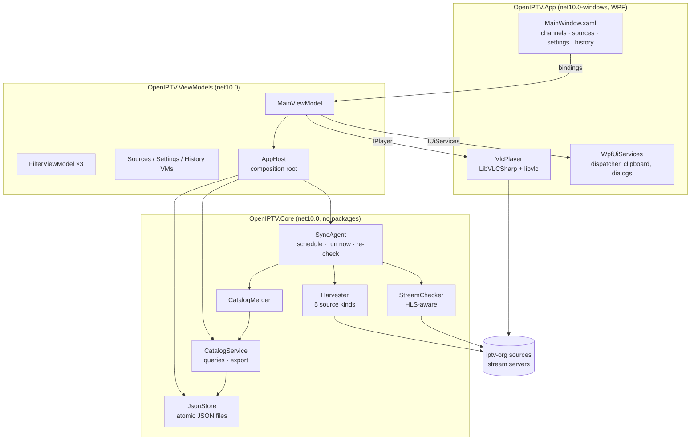
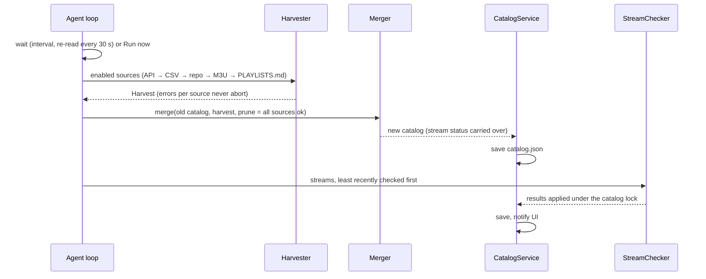

# OpenIPTV for Windows — Architecture

| Item | Value |
|---|---|
| Document | Architecture v1.1 |
| Product version | 1.0.0 |
| Date | 2026-10-26 |

## 1. Overview

One Windows process with three layers. Only the top layer depends on WPF or VLC, so the logic can be built and tested on any OS.



| Project | Responsibility |
|---|---|
| `OpenIPTV.Core` | Models, parsers (M3U, CSV, PLAYLISTS.md), harvesters, merge rules, stream checker, sync agent, catalog queries/export, JSON storage |
| `OpenIPTV.ViewModels` | MVVM layer (`INotifyPropertyChanged`, `ICommand`): filters, sorting, selection, playback commands, pages; talks to the UI only through `IUiServices` and `IPlayer` |
| `OpenIPTV.App` | XAML, splash window, code-behind for navigation, full screen, grid gestures and column-header sorting; `VlcPlayer` (LibVLC), `WpfUiServices` (dialogs, clipboard, theme), `LogoImage` (async logo loading with cache and a default picture), converters; `Assets/` (app icon, default channel picture) |
| `OpenIPTV.Tests` | Console test runner: parsers, merge, storage, checker against a local HTTP server, a full agent cycle, view models; `--live` syncs real iptv-org sources |

### Technology choices

* **C# / .NET 10 + WPF:** native Windows app, mature data grid with virtualisation, and a single-file self-contained publish.
* **LibVLC (VLC engine):** plays HLS, DASH, RTMP, RTSP and UDP/multicast with per-media HTTP headers. A browser player such as Electron or WebView2 handles only HLS/HTTP and is limited by CORS; the IPTV Portal needed a proxy for that, and this app does not.
* **JSON files instead of a database:** about 12k channels / 18k streams take about 8 MB, load in about 0.2 s, and any search or filter takes 5–50 ms (measured). The app needs no database engine or NuGet dependency in the core. `CatalogService` hides storage, so SQLite can replace it later.

## 2. Data model

`Catalog` (catalog.json):
* **Channels:** id → `Channel`. Each channel holds id, name, alt names, category ids, language codes, country code, logo, website, NSFW flag, origins, first/last seen, and a list of `StreamInfo`.
* **Each `StreamInfo`:** url, title, feed, quality, labels, referrer, user agent, origins, status, last checked, last result, fail count.
* **Lookups:** country code → name, language code → name, category id → name. All are case-insensitive.

Channel status is derived from its streams (active if any stream is active), never stored.

Other files: `sources.json` (list of `SourceConfig`), `settings.json` (`AppSettings`: sync and check settings, theme, plus the last-used search text, Category/Language/Country selections, status, sort, page size and volume), `history.json` (last 100 `SyncRun`; can be cleared), `openiptv.log` (rotates at 2 MB to `openiptv.log.1`; can be cleared).

## 3. Sync cycle



Merge rules (identical to the IPTV Portal):
* **Channel key:** the iptv-org id; the `@feed` suffix of `tvg-id` is dropped.
* **Single values:** a source with a higher priority value overwrites a lower one. Priority from highest: API, CSV, repository/M3U, PLAYLISTS.md.
* **Lists:** combined across all sources.
* **Logo:** API/CSV logos (feed-less, in use, widest first) win over `tvg-logo`.
* **Language:** taken from the main feed, then from the stream's feed, then from language playlists.
* **Country:** a two-letter id suffix (e.g. `.sg`) or a repository file name gives a fallback country.

## 4. Stream checks

```
http(s): GET with Referer/User-Agent (≤512 KB read)
  ├─ ≥400 / HTML / no data → inactive
  ├─ HLS master → first variant (≤3 levels) → media playlist → GET first segment (Range 64 KB) → active if bytes
  └─ other media bytes → active
rtmp/rtsp/mms/srt: TCP connect → "reachable" (active)
udp/rtp: cannot be tested remotely → stays unchecked
```

A global concurrency limit applies (default 40), plus 4 per host. The per-stream timeout is `timeout × 2.5`. Checks run on copies of the stream data, so the catalog lock is held only to apply results.

## 5. Threading

* **The agent** runs on the thread pool, and the catalog is guarded by one lock. The sync history list has its own lock; the UI reads a snapshot (`HistorySnapshot`), and **Clear history** goes through the agent.
* **Queries** return immutable rows (`ChannelRow`, `ChannelDetail`, `StreamView`), so the UI never touches live objects.
* **Events** from the agent and the player are marshalled to the UI thread via `IUiServices.Post`.
* **List refreshes** are debounced: search at 250 ms, catalog changes at 800 ms. While streams are being checked, only the counts refresh, so the list does not jump while the user scrolls.
* **Logos** download in the background through WPF's `BitmapImage`; `LogoImage` shows the default picture until a logo arrives and checks that a recycled grid row still shows the same channel before applying it.
* **LibVLC calls** run on a serial background queue. They are never made from VLC callbacks, and `Stop()` cannot freeze the UI.

## 6. User interface

Start-up: `App.OnStartup` shows `SplashWindow`, loads the data folder and catalog and starts the VLC engine on background threads (reporting progress), builds the main window, then fades the splash out and starts the agent.

The main window has a header (icon, name, version badge, page switcher, totals, sync state, **Sync now**) and four pages:

| Page | Contents |
|---|---|
| Channels | Search box; Category/Language/Country pop-up multi-select filters with search; Status (default Active); two sort keys + descending; counts line with the shown range; Export M3U/CSV; virtualised grid (logo or default picture, name, category, language, country, code, sources, status) with sortable column headers; pager (first/prev/page box/next/last, per-page 25–500). Right: VLC video with overlay messages, controls (mute turns orange while muted), details (logo, category, language, country, status/last check, website), source picker, source URL + Copy, Check source now. |
| Sources | Editable grid (on, name, kind, URL, options, last run, last status), add/remove/restore defaults, revert/save with validation. |
| Settings | Theme (System/Light/Dark, applied immediately); interval, sync on start-up, test during sync, concurrency, timeout, cap, cooldown, network caching, TLS, NSFW, keep empty channels, GitHub token; data folder; About with version. |
| Sync history | Last 100 syncs with **Clear history**; live log with **Open log file** and **Clear log**. |

Theme: WPF Fluent (`Application.ThemeMode`) with orange accents. `WpfUiServices.ApplyTheme` switches System/Light/Dark and swaps the pop-up panel colour; in System mode it follows Windows light/dark changes live.

Paging and sorting live in `MainViewModel`: a query returns every matching row (`_allRows`), sorted by `CatalogService.Sort`; the view model slices the current page. Column-header clicks are intercepted (`DataGrid.Sorting`, handled) and call `SortByColumn`, so sorting always covers all pages; the header arrow is redrawn from `Sort1`/`SortDescending`. **Full screen** hides everything except the video and its controls.

## 7. Packaging

`build.bat` runs the tests, then publishes `src/OpenIPTV.App` self-contained for `win-x64`:

* **Single-file (default):** `PublishSingleFile`, `IncludeNativeLibrariesForSelfExtract` and `IncludeAllContentForSelfExtract` bundle .NET, WPF and the VLC engine. Compression is on. The output is `dist\OpenIPTV-<version>-win-x64.exe`. If the VLC files are copied beside the exe rather than bundled, the script zips the exe and the `libvlc` folder together. `VlcPlayer` looks for `libvlc\win-x64` in both the extraction folder and the exe folder.
* **`--onedir`:** an app folder plus a zip.

Only the 64-bit VLC engine is included (`VlcWindowsX86Enabled=false`). The exe icon comes from `Assets/openiptv.ico` (16–256 px; a simplified design at 32 px and below). The version comes from `Directory.Build.props` and is embedded in the assembly and file properties.

## 8. Extension points

* **New source kinds:** add a case in `Harvester.HarvestAllAsync` and an `Ingest` method.
* **SQLite storage:** replace `JsonStore` and `CatalogService` internals; their public API stays.
* **Favourites and EPG:** add fields to `Channel` / new files in the data folder; the view models already persist UI state.
* **Linux/macOS:** Core and ViewModels are cross-platform. An Avalonia front end with LibVLCSharp.Avalonia could reuse them unchanged.
